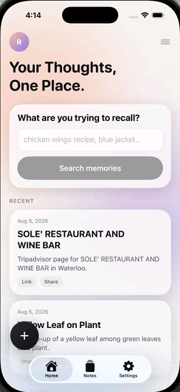
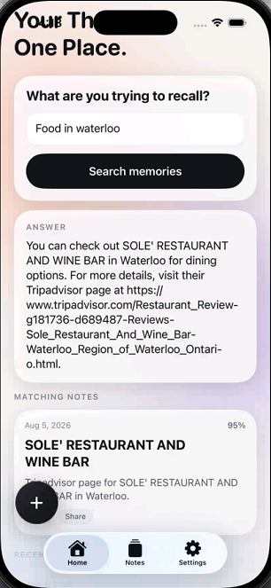
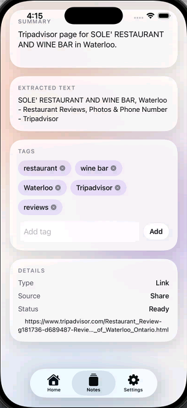
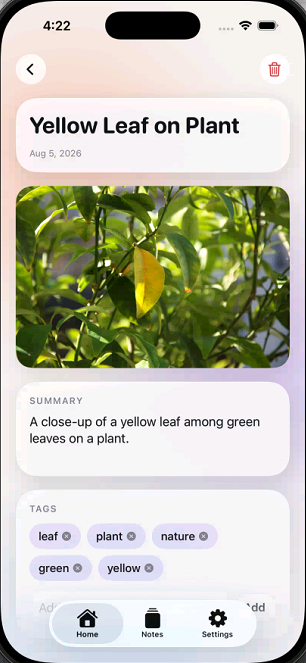
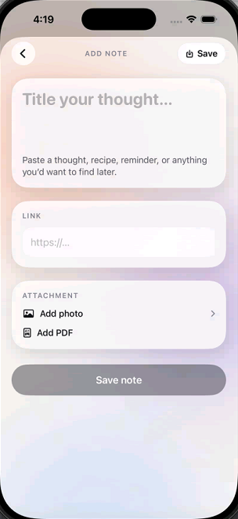
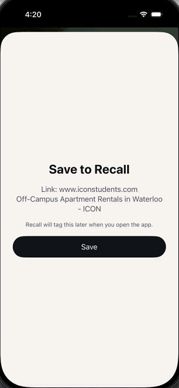

# Recall

Recall is a personal AI memory app for iOS. Save links, images, PDFs, and text through the Share sheet, then ask natural-language questions like "the chicken wings recipe" or "the blue jacket I saved."

## Screenshots

<table>
  <tr>
    <td align="center"><br/><sub>Home: search and recent memories</sub></td>
    <td align="center"><br/><sub>Ask a question, get an answer with sources</sub></td>
    <td align="center"><br/><sub>Saved link: summary, extracted text, tags</sub></td>
  </tr>
  <tr>
    <td align="center"><br/><sub>Photo memory with AI summary and tags</sub></td>
    <td align="center"><br/><sub>Add a note, link, photo, or PDF</sub></td>
    <td align="center"><br/><sub>Save from any app via the Share Sheet</sub></td>
  </tr>
</table>

## Product status

**V1 (now):** Share + Ask only · user OpenAI API key (dev)  
**V2 (later):** Photo Library indexing with locked cost controls  
**Ship later:** Subscriptions / your backend  

See [PRODUCT.md](PRODUCT.md) for locked decisions.

## Repo

- GitHub: https://github.com/jwu0216/Recall.git
- Bundle ID: `com.jwu0216.recall`
- App Group: `group.com.jwu0216.recall`

## Windows development

1. Edit Swift files in Cursor
2. Commit and push to GitHub
3. GitHub Actions compiles on a macOS runner
4. For simulator testing, use MacinCloud and run `xcodegen generate`

## Push from Windows

```bash
cd /d/Recall
git add .
git commit -m "Your message"
git push
```

## Generate Xcode project on Mac

```bash
git clone https://github.com/jwu0216/Recall.git   # or: git pull
cd Recall
xcodegen generate
open Recall.xcodeproj
```

Then select an iPhone simulator and press Run.

**Do not commit `Recall.xcodeproj`** — regenerate it each Mac session.

## Share extension testing

1. In Xcode, choose the `RecallShare` scheme
2. Run and pick Safari as the host app
3. Share a link or image to Recall
4. Open the main Recall app to finish tagging (needs API key)

## OpenAI setup

Add your API key in the app under Settings. Used for embeddings, tagging, and answers.

## Project layout

- `project.yml` — XcodeGen project definition
- `PRODUCT.md` — V1/V2 product decisions (including Photos cost rules)
- `Recall/` — main SwiftUI app
- `RecallShare/` — Share extension
- `RecallCore/` — shared models and services
- `.github/workflows/ios-build.yml` — compile-only CI

## Notes

- Apple Developer account is only required for TestFlight / App Store
- Photos indexing is intentionally not in V1
